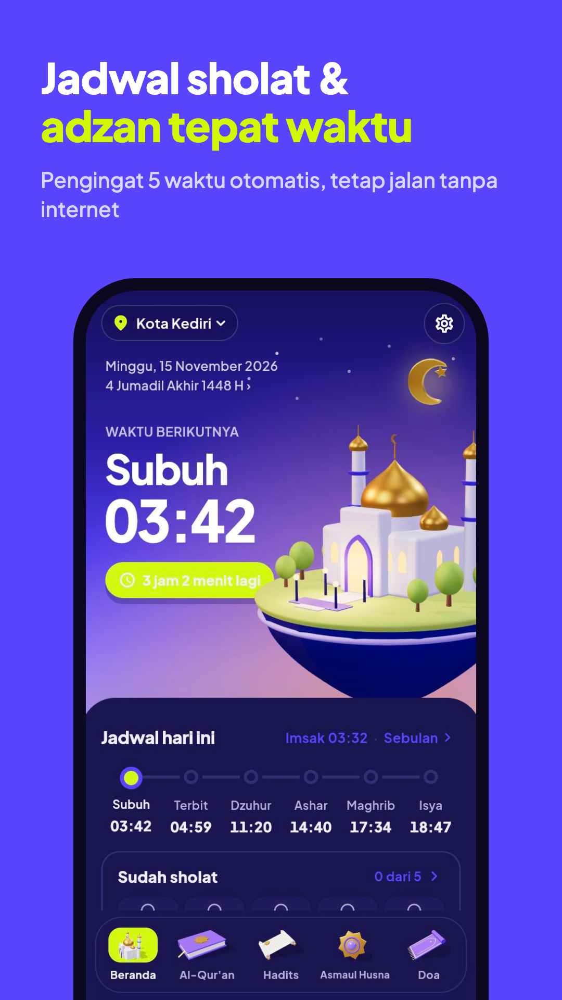
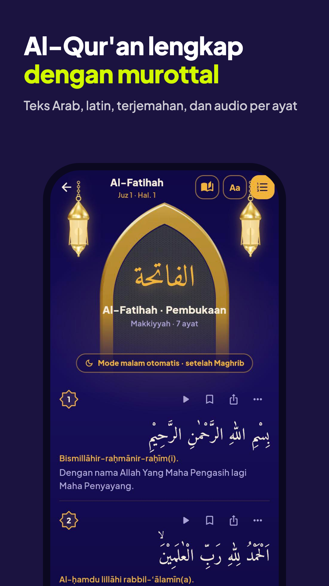
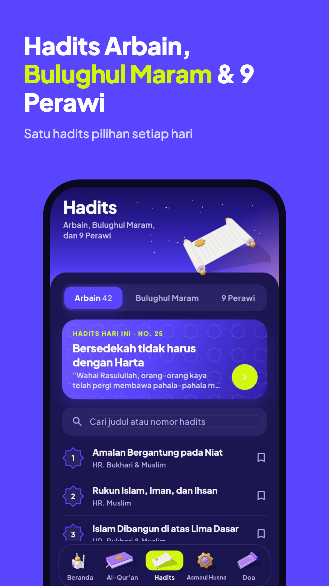
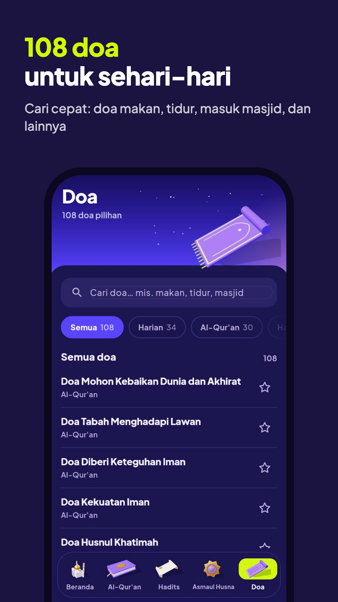

# Muslimku

Muslimku is a daily companion app for Muslims in Indonesia, built with Flutter.
It works offline once content has been opened or saved.

<p align="center">
  
  
  
  
</p>

## Features

| Area | What it does |
|---|---|
| Prayer times | Today's times for any Indonesian city, a monthly table, per-prayer minute corrections, adzan and extra reminders, a prayer log, and an Android home-screen widget |
| Al-Qur'an | 114 surahs, juz, themes and bookmarks; tajweed colours, tafsir Kemenag, murottal by several qari (streamed or saved), mushaf by page, khatam plan, share an ayah as an image |
| Hadith | Arbain An-Nawawi, Bulughul Maram and the 9 perawi, with search and favourites |
| Doa | 108 doa with categories, search and favourites |
| Asmaul Husna | The 99 names, a name of the day and a quiz |
| More | Hijri calendar, qibla compass, tasbih, light and dark themes, in-app update notice |

## Getting started

Requirements: [fvm](https://fvm.app) (the Flutter version is pinned in
`.fvmrc`), Android Studio or Xcode.

```bash
fvm install
fvm flutter pub get
fvm flutter run
```

Checks that CI runs on every pull request:

```bash
fvm dart format --output=none --set-exit-if-changed lib test
fvm flutter analyze
fvm flutter test
```

## Project layout

The code is organised by feature. Each feature keeps its own data access,
pure logic, state and UI:

```
lib/
  main.dart            boots the app
  app/                 root widget, splash, tab shell
  core/                no feature knowledge: network, storage, theme, time
  shared/              state and widgets used by several features
  features/
    prayer/            data/ domain/ application/ presentation/
    quran/
    hadith/  doa/  asmaul_husna/  calendar/  qibla/  tasbih/
    location/  home/  onboarding/  settings/  app_update/
test/                  mirrors lib/
```

See [docs/ARCHITECTURE.md](docs/ARCHITECTURE.md) for the layers, the
dependency rules and how state is handled.

## Data sources

Muslimku has no backend of its own. Content comes from public APIs and is
cached on the phone:

- [MyQuran API v2](https://api.myquran.com): prayer times, cities, Qur'an,
  hadith, doa, Asmaul Husna
- [equran.id](https://equran.id): tafsir Kemenag
- [alquran.cloud](https://alquran.cloud): tajweed markup
- [Islamic Network CDN](https://cdn.islamic.network): murottal audio

Location is only used on the device, to pick the nearest city and the qibla
direction. See the privacy policy screen in the app
(`lib/features/settings/presentation/privacy_policy_screen.dart`).

## Contributing

See [CONTRIBUTING.md](CONTRIBUTING.md).

## License

Code: [MIT](LICENSE). Fonts are under the SIL Open Font License
(`fonts/OFL-*.txt`).
